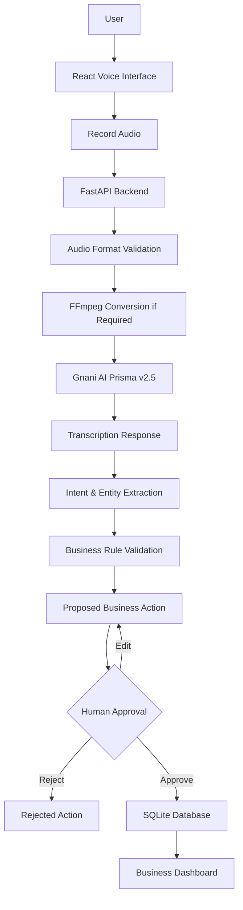

# VoxFlow — Multilingual Voice-to-Action Platform

## 1. Project Overview

**VoxFlow** is a multilingual voice-to-action application designed to simplify everyday business operations for small retailers and local businesses.

Instead of navigating multiple forms and manually entering transaction details, a business owner can communicate through natural speech. VoxFlow converts the audio into text, interprets the requested operation, extracts relevant business information, validates the proposed action and presents it for human approval.

The approved information is then stored and made accessible through a business dashboard.

The platform combines speech recognition, backend processing, business logic and human-in-the-loop decision-making into a single workflow.

### Core Concept

**Voice Input → Speech Recognition → Intent & Entity Extraction → Validation → Human Approval → Database → Dashboard**

## 2. Problem Statement

Small businesses often manage customer orders, product quantities, delivery information and payment reminders through manual processes.

These workflows can become inefficient because:

- Information is frequently recorded manually.
- Traditional software interfaces require structured data entry.
- Language barriers can make digital tools less accessible.
- Voice recognition errors can lead to incorrect business records.
- Business owners need a simple way to review and manage daily operations.

VoxFlow explores a voice-first approach to make these workflows more accessible and efficient.

## 3. Proposed Solution

VoxFlow provides an interface where users can speak business instructions in supported languages and communication styles.

The backend processes the recording through Gnani AI Prisma v2.5, receives the transcript and applies application-side intent and entity extraction.

The extracted information is validated before it can become a saved business record.

A human approval stage ensures that the user remains in control of important business operations.

### Example

**User input:**

"आज अमित को 5 किलो बासमती चावल बेचना है। कल डिलीवरी करनी है।"

**Illustrative structured output:**

```json
{
  "intent": "CREATE_ORDER",
  "customer": "Amit",
  "product": "Basmati Rice",
  "quantity": 5,
  "unit": "kg",
  "delivery_date": "tomorrow"
}
```

The application then presents the proposed order for review. The final transaction amount must come from the configured product price, not an invented value.

## 4. Key Features

| Feature | Description |
|---|---|
| Voice-based interaction | Capture business instructions through browser audio recording |
| Speech-to-text | Integrate Gnani AI Prisma v2.5 |
| Multilingual input | Process supported Hindi, English and code-mixed speech |
| Intent extraction | Identify supported business operations |
| Entity extraction | Identify customer, product, quantity and relevant values |
| Input validation | Detect incomplete or invalid information |
| Human approval | Review, edit, approve or reject proposed actions |
| Order management | Create and manage customer order records |
| Payment reminders | Create and manage reminder records |
| Persistent storage | Store approved business records in SQLite |
| Dashboard | View and manage saved business information |
| Audio compatibility | Handle browser audio formats and conversion requirements |

Language coverage and extraction accuracy depend on the actual audio, speech recognition response and implemented parsing rules.

## 5. End-to-End Application Workflow



### Step 1 — Audio Capture

The React frontend provides the voice recording interface.

The browser records the user's speech and creates an audio Blob using a supported recording format.

### Step 2 — Audio Processing

The audio is sent to the FastAPI backend.

The backend checks the audio format and uses FFmpeg when conversion is required to prepare compatible audio for speech recognition.

### Step 3 — Speech Recognition

The backend communicates with the Gnani AI Prisma v2.5 speech-to-text API.

The API returns the recognized speech, which becomes the input for subsequent processing.

### Step 4 — Intent and Entity Extraction

The transcript is processed using application-side logic to identify the supported operation and extract relevant fields.

Examples include:

- Customer name
- Product name
- Quantity
- Measurement unit
- Transaction amount
- Delivery information
- Reminder information

This stage uses deterministic application logic and parsing rules; it should not be confused with an integrated LLM-based reasoning system.

### Step 5 — Validation

The extracted information is checked for completeness and consistency.

For example:

- Is the customer identified?
- Is the product recognized?
- Is the quantity valid?
- Is a required transaction value missing?
- Does the proposed action contain sufficient information?

Incomplete information should be flagged for correction.

### Step 6 — Human-in-the-Loop Approval

The proposed action is displayed to the user.

The user can:

- Review extracted information.
- Correct incorrect fields.
- Approve the proposed action.
- Reject the proposed action.

### Step 7 — Database Persistence

Approved business records are stored in SQLite and made available through the dashboard.

---

## 6. Technology Stack

| Layer | Technology | Responsibility |
|---|---|---|
| Frontend | React | User interface |
| Frontend language | TypeScript | Type-safe application development |
| Backend | Python | Business logic and processing |
| Backend framework | FastAPI | REST API development |
| Speech AI | Gnani AI Prisma v2.5 | Speech recognition |
| Audio processing | FFmpeg | Audio conversion and compatibility |
| Database | SQLite | Persistent application data |
| Testing | Pytest | Backend automated testing |
| Development | Git | Version control |

## 7. Architecture and Design Decisions

### Frontend-Backend Separation

The frontend and backend have separate responsibilities.

**Frontend:**
- Audio recording.
- Displaying transcripts.
- Showing extracted business information.
- Managing approval interactions.
- Displaying saved records.

**Backend:**
- Receiving audio.
- Processing audio formats.
- Communicating with the speech recognition API.
- Extracting intent and entities.
- Applying business validation.
- Persisting approved information.

### Why FastAPI?

FastAPI provides a lightweight Python backend framework with request validation, asynchronous support and automatic interactive API documentation.

It also makes integration with Python-based AI and audio-processing libraries straightforward.

### Why SQLite?

SQLite provides a lightweight persistent database suitable for local development and an initial single-instance application.

A production multi-user deployment would require a more scalable database architecture.

### Why Human-in-the-Loop?

Speech recognition and entity extraction can produce incorrect results.

Allowing users to review proposed operations before saving them provides an important safeguard against unintended business records.

### Why FFmpeg?

Browser recording formats vary depending on browser capabilities.

FFmpeg provides a way to convert supported audio formats into a format suitable for downstream processing.

---

## 8. Gnani AI Integration

VoxFlow integrates **Gnani AI Prisma v2.5** for speech-to-text processing.

### Integration Flow

1. The user records audio in the frontend.
2. The backend receives the audio file.
3. Audio compatibility is checked.
4. The backend sends the audio to the Gnani speech recognition API.
5. The transcript is received.
6. The transcript is passed into the application's processing pipeline.

### API Configuration

The integration uses the Gnani API endpoint:

```text
https://api.vachana.ai/stt/v3
```

The backend authenticates using the API key identifier in the request header.

Credentials must be stored in backend environment variables and must never be exposed in frontend code or committed to GitHub.

### Model Scope

| Model | Integration status |
|---|---|
| Gnani Prisma v2.5 | Integrated |
| Gnani Timbre v2.5 | Future extension |
| Gnani Evon v3.3 | Future extension |

The current application does not claim to use Timbre for speech synthesis or Evon for LLM-based reasoning.

---

## 9. Example Business Workflows

### A. Customer Order Creation

**Voice command:**

```text
आज अमित को 5 किलो बासमती चावल बेचना है।
कल डिलीवरी करनी है।
```

**Information to extract:**

| Field | Example |
|---|---|
| Operation | Create order |
| Customer | Amit |
| Product | Basmati Rice |
| Quantity | 5 |
| Unit | kg |
| Delivery | Tomorrow |

The user reviews the proposed order before saving it.

### B. Payment Reminder

**Voice command:**

```text
रमेश से 1500 रुपये लेने हैं।
उसे कल शाम भुगतान के लिए याद दिलाना।
```

**Information to extract:**

| Field | Example |
|---|---|
| Operation | Payment reminder |
| Customer | Ramesh |
| Amount | ₹1,500 |
| Reminder | Tomorrow evening |

### C. English Order Creation

**Voice command:**

```text
Create an order for Amit, 2 packets of Tata Salt,
delivery tomorrow.
```

The application processes the instruction and presents the extracted order information for review.

*These are representative workflow examples. Actual extraction depends on the implemented rules and tested inputs.*

---

## 10. API Documentation

VoxFlow exposes backend functionality through FastAPI endpoints.

The interactive API documentation is available locally at:

```text
http://localhost:8000/docs
```

The application includes a voice transcription endpoint:

```http
POST /api/v1/voice/transcribe
```

The endpoint accepts audio input and returns the transcription response.

Other business endpoints are documented through the running FastAPI application.

For the exact endpoint list, request schemas and response models, refer to the live `/docs` interface.

---

## 11. Project Structure

The following is a representative view of the major application components. Keep the actual directory names and paths consistent with the repository.

```text
voxflow/
│
├── backend/
│   ├── app/
│   │   ├── main.py
│   │   ├── api/
│   │   └── services/
│   │       ├── gnani_stt.py
│   │       └── audio_converter.py
│   │
│   ├── tests/
│   ├── requirements.txt
│   └── .env.example
│
├── src/
│   ├── components/
│   ├── pages/
│   │   └── VoiceAssistantPage.tsx
│   ├── services/
│   │   └── voiceService.ts
│   └── ...
│
├── package.json
├── vite.config.ts
└── README.md
```

### Important Components

| Component | Responsibility |
|---|---|
| `main.py` | Backend application entry point |
| `gnani_stt.py` | Speech recognition integration |
| `audio_converter.py` | Audio conversion and compatibility |
| `VoiceAssistantPage.tsx` | Voice interaction interface |
| `voiceService.ts` | Frontend voice API communication |
| `tests/` | Backend automated tests |

---

## 12. Installation and Local Setup

### Prerequisites

Install the following before running the project:

- Python 3.10 or later
- Node.js and npm
- FFmpeg
- Git
- Gnani AI API credentials

### Step 1 — Clone the Repository

```bash
git clone YOUR_REPOSITORY_URL
cd voxflow
```

Replace the repository URL and directory name with the actual values.

### Step 2 — Set Up the Backend

```powershell
cd backend

python -m venv venv

.\venv\Scripts\Activate.ps1

pip install -r requirements.txt
```

### Step 3 — Configure Environment Variables

Create a `.env` file using the example configuration.

```env
GNANI_API_KEY=your_api_key_here
```

Use the exact environment variable name expected by the current backend implementation.

**Security:** Never commit the real `.env` file or API credentials.

### Step 4 — Verify FFmpeg

```bash
ffmpeg -version
```

Ensure FFmpeg is available through the system PATH or configured executable path.

### Step 5 — Start the Backend

From the backend directory:

```powershell
python -m uvicorn app.main:app --reload --port 8000
```

Backend:

```text
http://localhost:8000
```

API documentation:

```text
http://localhost:8000/docs
```

### Step 6 — Start the Frontend

Open another terminal in the project root.

```bash
npm install
npm run dev
```

Frontend:

```text
http://localhost:3000
```

The development server may display a different port if the configured port is already in use.

---

## 13. Testing

The backend uses Pytest for automated testing.

Run the tests from the backend directory:

```powershell
.\venv\Scripts\python.exe -m pytest tests/ -v
```

### Previously Verified Test Result

```text
10 passed
3 warnings
```

The previously observed warnings concerned Pydantic configuration deprecation and were non-fatal.

Re-run the suite before publishing any updated test count.

### Recommended Functional Verification

| Area | Verification |
|---|---|
| Audio recording | Start and stop recording |
| Audio handling | Check supported browser formats |
| Speech recognition | Receive a Gnani transcription |
| Intent extraction | Identify supported operations |
| Entity extraction | Check customer, product and quantity |
| Validation | Detect missing or invalid information |
| Approval | Test edit, approve and reject |
| Persistence | Verify approved records are saved |
| Dashboard | Verify saved records are displayed |
| Reminders | Verify reminder creation and retrieval |

Automated tests do not replace end-to-end testing of the complete user workflow.

---

## 14. Security and Reliability Considerations

VoxFlow is designed with several important engineering considerations:

**Credential protection**
- Keep API keys on the backend.
- Use environment variables for configuration.
- Exclude secret files from version control.

**Input validation**
- Validate incoming requests and business data.
- Handle missing or invalid information.
- Avoid silently inventing missing business values.

**Audio error handling**
- Check audio compatibility before processing.
- Handle conversion failures.
- Handle speech recognition API errors.

**Human approval**
- Keep proposed actions separate from approved records.
- Require user review before saving business operations.

**Data integrity**
- Persist approved records.
- Avoid treating an unverified transcript as a completed transaction.

---

## 15. Current Scope and Limitations

VoxFlow is an initial implementation and engineering prototype, not a fully deployed enterprise business management platform.

Current scope includes:
- Browser-based voice recording.
- Gnani Prisma v2.5 speech recognition integration.
- Application-side intent and entity extraction.
- Business validation and approval workflow.
- Order and reminder management.
- SQLite-based persistence.
- Dashboard-based record management.

Areas requiring further development include:
- Broader language and accent coverage.
- More robust extraction for unrestricted speech.
- Production-grade authentication and authorization.
- Multi-user and multi-tenant support.
- Cloud deployment and monitoring.
- Advanced conversational reasoning.
- Production-scale database infrastructure.

---

## 16. Future Roadmap

Potential extensions include:

| Area | Planned improvement |
|---|---|
| Speech | Expanded Indic-language support |
| Text-to-speech | Gnani Timbre integration |
| Reasoning | Gnani Evon integration |
| Interaction | Real-time streaming voice |
| Business | Inventory and customer management |
| Integrations | WhatsApp and telephony |
| Infrastructure | Cloud deployment |
| Database | PostgreSQL migration |
| Security | Authentication and role-based access |
| Observability | Structured logging and monitoring |

These items are planned enhancements, not claims about currently implemented functionality.

---

## 17. Challenge Information

**Project:** VoxFlow  
**Challenge:** The Great Indian AI Internship Challenge 2026  
**Category:** Voice AI / AI Engineering / Business Automation  
**Participation:** Solo  
**Primary Gnani integration:** Prisma v2.5

The project explores how speech AI can make everyday business operations more accessible through natural-language interaction.

---

## 18. Author

**Somya Devda**

B.Tech — Computer Science and Engineering (AI & ML)  
School of Information Technology, RGPV

- GitHub: YOUR_GITHUB_PROFILE_URL
- LinkedIn: YOUR_LINKEDIN_PROFILE_URL

---

<p align="center">
  <strong>VoxFlow</strong>
  <br/>
  Speak naturally. Manage smarter.
</p>
